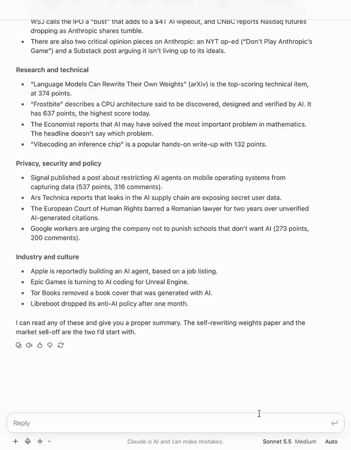
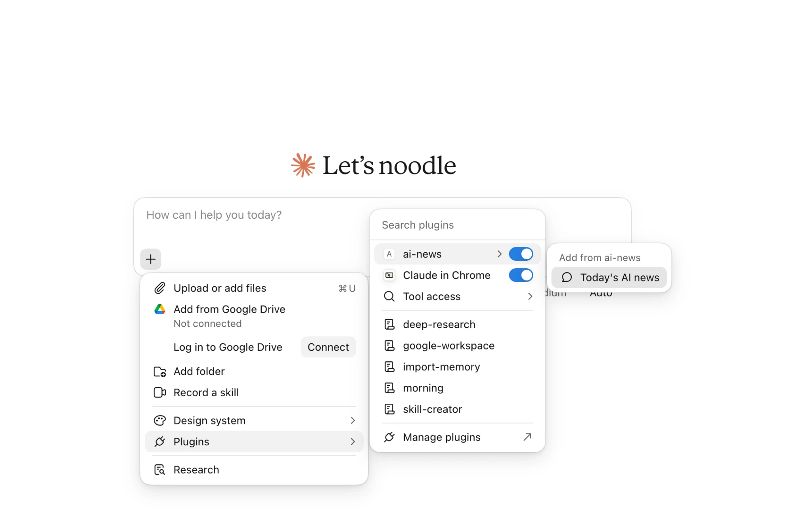

# ai-news-mcp

Daily AI news from Hacker News, right inside Claude Desktop.


## What it does

- Fetches AI-related stories from Hacker News once a day and stores them on your Mac.
- Lets Claude list, search, read and summarize them for you.
- No API key needed. Summarizing is done by Claude itself.

## How it works

1. Every day at 09:00, a launchd job fetches the Hacker News top and best stories and keeps the AI-related ones, using a keyword filter on the title. If the Mac is off or the fetch fails, it retries every hour until 23:00.
2. Story metadata (title, link, score, comment count, date) is saved to a local SQLite database. Stories older than 30 days are deleted.
3. Claude Desktop talks to the database through an MCP server. When Claude needs an article, the server fetches its text on demand from the web page, PDF or Hacker News post.

## Requirements

- macOS
- [Claude Desktop](https://claude.ai/download)
- [uv](https://docs.astral.sh/uv/)

## Install

```bash
git clone https://github.com/devardagur/ai-news-mcp.git
cd ai-news-mcp
uv run ai-news-mcp install
```

This adds the server to Claude Desktop, schedules the daily fetch and runs the first fetch. Then restart Claude Desktop.

Claude Desktop and the daily job run the code from the cloned folder, so keep the folder where it is.

## Usage

Ask Claude things like:

- "What's new in my AI news today?"
- "Any news about Anthropic this week?"
- "Summarize the top AI stories from last Monday."

Claude can also read and summarize an article for you:



For a daily summary, pick the **Today's AI news** prompt from **+ → Plugins → ai-news**:



### Tools

| Tool | What it does |
| --- | --- |
| `latest_news` | Stories that first appeared in the latest daily fetch |
| `list_news` | Stories from a date or date range (last 30 days) |
| `search_news` | Stories whose title contains a keyword |
| `get_article` | The readable text of a story's article |
| `get_discussion` | A story's top Hacker News comments, in Hacker News order |

## Uninstall

Quit Claude Desktop first (Cmd+Q), then run from the cloned folder:

```bash
uv run ai-news-mcp uninstall
```

This removes the Claude Desktop entry and the daily job, and deletes the database and logs. Then you can delete the cloned folder.

## Files

| Path | What it is |
| --- | --- |
| `~/.ai-news-mcp/news.db` | Story database |
| `~/.ai-news-mcp/fetch.log` | Daily fetch log |
| `~/Library/LaunchAgents/com.ai-news-mcp.fetch.plist` | Daily fetch job |

## Project structure

```
ai-news-mcp/
├── docs/
│   └── SPEC.md         # Project spec
└── src/ai_news_mcp/
    ├── cli.py          # Commands: install, uninstall, fetch, serve
    ├── server.py       # MCP tools and prompt
    ├── fetcher.py      # Hacker News fetch, AI filter, article text, comments
    ├── db.py           # SQLite storage and 30-day cleanup
    └── installer.py    # Claude Desktop config and launchd job
```

## License

[MIT](LICENSE)
